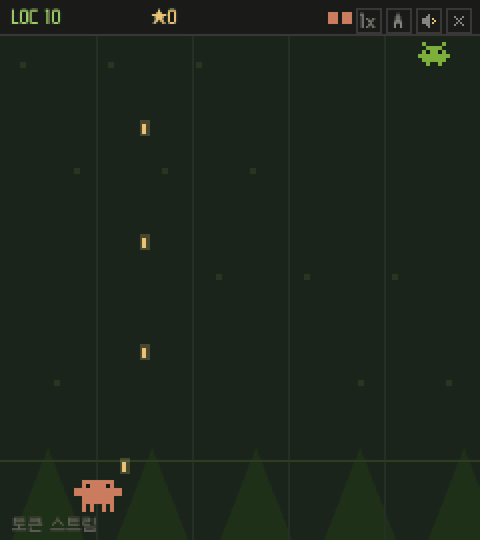

# claude_coder

[English](README.md) · 한국어

**떨어지는 버그를 막으며 코드 5000줄을 채우는 픽셀 디펜스 로그라이트.**

**[▶ 브라우저에서 바로 플레이](https://tinkerer0.github.io/claude_coder/)**



바닥의 Clawd가 다섯 줄로 떨어지는 버그를 막고, 버틴 만큼 LOC(코드 줄 수)가 쌓입니다. 한 판이 끝나면 모은 ★로 무기 17종과 능력치를 영구 강화하고 다시 도전합니다. 5000 LOC를 채우면 "배포 성공"입니다.

← → 또는 A / D로 줄을 옮기면 공격은 자동입니다. 1·2·3은 게임 속도, M은 소리, Esc는 이번 판 끝내기입니다. 모바일에서는 화면을 눌러 옮깁니다.

같은 게임의 다른 캐릭터판: [dino_coder](https://github.com/tinkerer0/dino_coder) · [duck_coder](https://github.com/tinkerer0/duck_coder)

## 직접 실행

빌드가 필요 없는 HTML 파일 하나입니다.

```sh
git clone https://github.com/tinkerer0/claude_coder.git
cd claude_coder
python3 -m http.server 8080   # http://localhost:8080 열기
```

진행 상황은 이 브라우저(`localStorage`)에만 저장됩니다.

## Feedback

제가 이런 분야를 접한 지 얼마 안 돼서 부족한 점이 많습니다. 고칠 점이나 알려주실 내용이 있다면 issue나 PR로 남겨주시면 너무 감사하겠습니다.

I am still new to this, so there is a lot to improve. Issues and pull requests with fixes or suggestions are very welcome.

## License

게임 코드는 [MIT](LICENSE)입니다. Clawd 캐릭터 디자인은 Anthropic의 것이라 이 라이선스에 포함되지 않습니다. 이 게임은 Anthropic과 관계없는 개인 팬 게임입니다.
