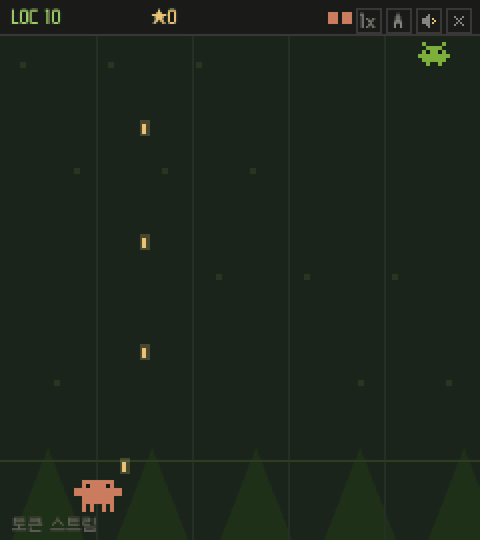

# claude_coder

English · [한국어](README.ko.md)

**A pixel defense roguelike where you block falling bugs to fill 5000 lines of code.**

**[▶ Play in the browser](https://tinkerer0.github.io/claude_coder/)**



Clawd at the bottom blocks bugs falling down five lanes, and the LOC (lines of code) count grows for as long as you hold out. When a run ends, you spend the ★ you collected to permanently upgrade 17 weapons and your stats, then try again. Fill 5000 LOC and you get "Deploy Succeeded".

Switch lanes with ← → or A / D, and attacks are automatic. 1, 2, and 3 set the game speed, M toggles sound, and Esc ends the current run. On mobile, tap the screen to move. The in-game text is in Korean.

Other character versions of the same game: [dino_coder](https://github.com/tinkerer0/dino_coder) · [duck_coder](https://github.com/tinkerer0/duck_coder)

## Run it yourself

It is a single HTML file and needs no build.

```sh
git clone https://github.com/tinkerer0/claude_coder.git
cd claude_coder
python3 -m http.server 8080   # open http://localhost:8080
```

Progress is saved only in this browser (`localStorage`).

## Feedback

I am new to this field and there is a lot I still get wrong. If you see something to fix or something I should know, an issue or PR would be very much appreciated.

## License

The game code is under the [MIT](LICENSE) license. The Clawd character design belongs to Anthropic and is not covered by this license. This game is a personal fan game and is not affiliated with Anthropic.
